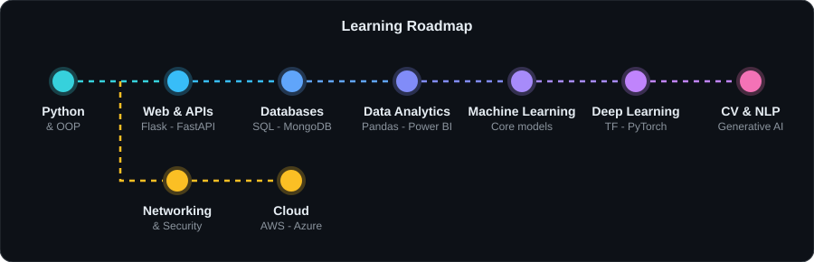

<div align="center">


<a href="https://github.com/JDevender007"></a>
<a href="https://www.linkedin.com/in/devender-j"></a>


</div>


## 👨‍💻 About Me

<div align="center">

</div>

I'm a **final-year Computer Science Engineering student** and **Python developer** who builds practical software and learns by shipping. I enjoy solving real-world problems with clean, maintainable code, and my interests sit across **data analytics, networking, AI and machine learning**.

My flagship repository documents that journey: **131 Python projects**, from beginner programs to advanced AI and enterprise-style applications, built with Object-Oriented Programming, modular architecture and Git version control.

Outside software, I have a background in **graphic design, motion graphics and video production** (Adobe Creative Cloud, DaVinci Resolve), which I use to create technical visuals and project presentations.

- 🔭 **Working on:** growing my portfolio across Python, data analytics, deep learning and networking
- 🌱 **Learning:** Machine Learning, Deep Learning, Computer Vision, NLP, Generative AI, Power BI
- 🎨 **Also into:** graphic design, motion graphics and video production
- 📫 **Reach me:** [LinkedIn](https://www.linkedin.com/in/devender-j)

### 🎯 Focus Areas

<table>
<tr>
<td align="center" width="25%"><h3>🐍</h3><b>Software Engineering</b><br/><sub>Clean, tested, modular Python with OOP</sub></td>
<td align="center" width="25%"><h3>📊</h3><b>Data Analytics</b><br/><sub>Analysis, visualization and dashboards</sub></td>
<td align="center" width="25%"><h3>🤖</h3><b>AI &amp; Deep Learning</b><br/><sub>ML, PyTorch, computer vision, NLP, GenAI</sub></td>
<td align="center" width="25%"><h3>📡</h3><b>Networking</b><br/><sub>Packet Tracer, GNS3, Wireshark</sub></td>
</tr>
</table>


## 📈 By the Numbers

<div align="center">

</div>


## 📂 Featured Repositories

| Repository | What it is |
|---|---|
| 🐍 **[Python](https://github.com/JDevender007/Python)** | Flagship repo: **131 projects**, from beginner programs to advanced AI. Covers OOP, file handling, data structures & algorithms, automation, web scraping, APIs, desktop apps, databases, networking, cybersecurity, cloud, data analysis and visualization, ML, deep learning, computer vision, NLP, Generative AI, IoT, robotics, image processing, DevOps and software engineering. |
| 📊 **[Data_Analyst](https://github.com/JDevender007/Data_Analyst)** | Data analytics portfolio, starting with a **Sales Performance Dashboard**. |
| 🧠 **[BrainTumorDiagnosis](https://github.com/JDevender007/BrainTumorDiagnosis)** | A modular deep-learning pipeline in Python, organised into configs, datasets, models, losses, metrics, optimizers, schedulers, a training engine, explainability and tests. |
| 📡 **[Networking](https://github.com/JDevender007/Networking)** | Planned network engineering portfolio of **50 projects**, beginner to advanced: Cisco Packet Tracer labs, routing and switching, enterprise design and network security. *In progress.* |

### 🗂️ Inside the Python Repository

<details>
<summary><b>🏗️ How every project is built</b></summary>

<br/>

The more advanced projects each ship with its own README, pinned `requirements.txt`, `.gitignore`, a modular `src/` package, a passing `pytest` suite, and a fully offline `--demo` that runs from bundled sample data, with no API keys, no network and no downloads.

```text
Project_Name/
├── src/              # main.py + library modules
├── tests/            # pytest test suite
├── data/             # bundled deterministic sample data
├── README.md
├── requirements.txt
└── .gitignore
```

</details>


## 🚀 Tech Stack

<div align="center">


</div>

### Languages
<p>


</p>

### Frameworks & Libraries
<p>


</p>

### Databases
<p>


</p>

### Currently Learning
<p>


</p>

### Tools
<p>


</p>

### Networking & Cloud
<p>


</p>

### Creative Tools
<p>


</p>


## 🧭 Learning Roadmap

<div align="center">

</div>


## 🐍 Contribution Snake

<div align="center">
<picture>
  <source media="(prefers-color-scheme: dark)" srcset="https://raw.githubusercontent.com/JDevender007/JDevender007/output/github-snake-dark.svg" />
  
</picture>
</div>


## 🤝 Connect With Me

<div align="center">

<a href="https://github.com/JDevender007"></a>
<a href="https://www.linkedin.com/in/devender-j"></a>

### Thanks for visiting my profile.

**Building. Learning. Sharing.**

⭐ Explore my repositories and follow my journey.

</div>
